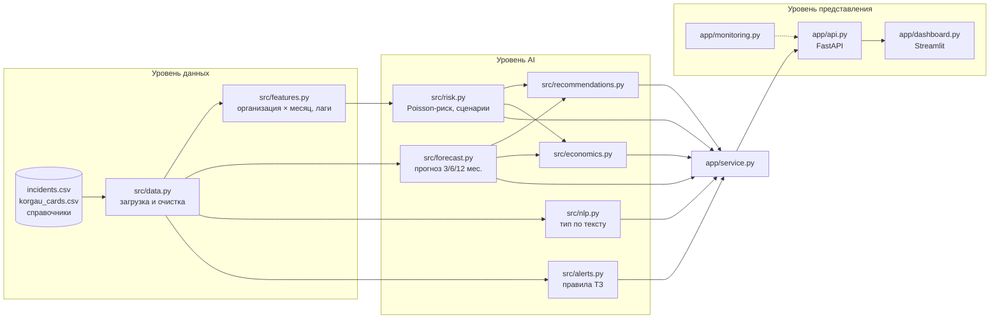

# Техническая документация — HSE AI Analytics

Прототип AI-модуля для ИС «Охрана труда» по ТЗ хакатона «Внедрение ИИ в сфере Охраны Труда» (`docs/TZ_hackathon_HSE.docx`).

## 1. Назначение

Модуль работает поверх двух журналов HSE-системы («Происшествия» и «Карта Коргау») и выдаёт:
(1) аналитику прошлых происшествий, (2) прогноз будущих рисков, (3) конкретные рекомендации, (4) экономический эффект в людях и тенге. Это целевой результат ТЗ, раздел 10.

## 2. Архитектура (ТЗ, раздел 5)

Поток данных: CSV → очистка → модели (обучены заранее `python -m src.train`, лежат в `models/`) → сервис → API → дашборд.

## 3. Структура проекта

| Путь | Одна задача |
|---|---|
| `data/` | синтетические данные по ТЗ (4 CSV) |
| `data_generation/generate_data.py` | воспроизводимый генератор данных (seed 42) |
| `src/data.py` | загрузка и очистка журналов |
| `src/features.py` | таблица «организация × месяц», лаговые признаки, временное разбиение |
| `src/forecast.py` | прогноз числа происшествий + backtesting |
| `src/risk.py` | риск организаций и локаций, сценарное моделирование |
| `src/nlp.py` | классификация текста + объяснение решения |
| `src/alerts.py` | алерты по правилам ТЗ 3.2.2 |
| `src/recommendations.py` | рекомендации с обоснованием |
| `src/economics.py` | эффект в людях и тенге, ROI |
| `src/train.py` | обучение и сохранение финальных моделей + паспорт |
| `src/plotting.py` | единый стиль графиков notebooks |
| `app/service.py` | связка модулей для API |
| `app/api.py` | REST API |
| `app/monitoring.py` | метрики работы сервиса и предсказаний |
| `app/dashboard.py` | веб-интерфейс |
| `models/` | сохранённые модели и `metadata.json` |
| `notebooks/01–04` | этапы курса: EDA, baseline, обучение, трансформеры |
| `tests/` | автотесты (pytest) |

## 4. Покрытие требований ТЗ

**Компонент A — «Происшествия»**

| № | Требование | Статус | Где |
|---|---|---|---|
| F-01 | NLP-классификация по типу | ✅ | `src/nlp.py`, `POST /classify` |
| F-02 | Паттерны: тип, организация, локация, время, сезон | ✅ | notebook 01, `GET /stats`, вкладка «Обзор» |
| F-03 | Анализ причин, группировка по корневым причинам | ✅ (группировка) | `GET /stats` → `top_root_causes` |
| F-04 | Автоматические рекомендации | ✅ | `src/recommendations.py`, `GET /recommendations` |
| F-05 | Дашборд в разрезе периода, типа, организации, локации | ✅ | вкладка «Обзор» |
| F-06 | Прогноз на 12, 6, 3 месяца | ✅ | `src/forecast.py`, `GET /forecast` |
| F-07 | Ущерб и экономия | ✅ | `src/economics.py`, `GET /economics` |
| F-08 | CV-анализ фотографий | ❌ вне объёма | в данных ТЗ (раздел 4.1) фотографий нет |
| F-09 | Экспорт отчётов | ⚠️ частично | таблицы дашборда выгружаются в CSV встроенной кнопкой |

**Алгоритм предиктивной модели (ТЗ 3.1.2)**

| Метод | Реализация |
|---|---|
| Time Series Analysis | тренд + сезонная гармоника; сравнение с SARIMA, Holt-Winters |
| Correlation Analysis | лаговая корреляция «Коргау → происшествия» (notebook 01) и абляция в модели риска (notebook 03) |
| Risk Scoring | Poisson-регрессия → ожидаемое число событий и индекс 0–100 |
| Scenario Modeling | `src/risk.scenario`: снижение нарушений на X% → изменение ожидаемых происшествий |

**Компонент B — «Карты Коргау»**

| № | Требование | Статус | Где |
|---|---|---|---|
| F-10 | Паттерны нарушений | ✅ | notebook 01, раздел 5.4 |
| F-11 | Алерты при превышении порога | ✅ | `src/alerts.py` (4 уровня ТЗ) |
| F-12 | Рейтинг организаций | ✅ | `GET /risk` (все организации) |
| F-13 | Корреляция нарушений с инцидентами | ✅ | r ≈ 0.28 при лаге 1 мес.; −4.8% deviance с признаками Коргау |
| F-14 | Pre-alert в зонах риска | ✅ | pre-alert для организаций из топа модели риска |
| F-15 | Классификация наблюдений по кластерам | ⚠️ | категория уже задаётся аудитором; классификатор аналогичен F-01 (будущая работа) |

**MVP (ТЗ, раздел 9):** дашборд ✅, прогноз 12/6/3 с интервалом ✅, топ-5 зон риска ✅, алерты Коргау ✅, ≥ 3 рекомендации ✅, KPI в людях и тенге ✅, Telegram (опционально) — нет.

## 5. Модели

| Модель | Вход | Выход | Качество (test) |
|---|---|---|---|
| Прогноз | месячный ряд | прогноз на 1–24 мес. + 90% интервал | MAE 4.8, RMSE 5.2 (backtest MAE 5.6) |
| Риск | 7 лаговых признаков организации | ожидаемое число происшествий в след. месяце | MAE 1.97, Poisson deviance 1.96 |
| Текст | описание (рус., 10–5000 символов) | 1 из 4 типов, оценки, слова-обоснования | accuracy 0.95, macro-F1 0.92 |

Версия, гиперпараметры, метрики, версии библиотек и контрольные суммы данных записываются в `models/metadata.json` (`GET /model-info`). Переобучение: `python -m src.train`.

## 6. API

| Метод | Путь | Назначение |
|---|---|---|
| GET | `/health` | готовность (200) или 503, если модели не загружены |
| GET | `/model-info` | паспорт моделей |
| GET | `/monitoring` | запросы, ошибки, задержка p50/p95, распределение предсказаний |
| GET | `/stats?date_from&date_to&org_id&type&location` | статистика с фильтрами |
| GET | `/forecast?horizon=12` | прогноз по месяцам и по типам + сводка 3/6/12 |
| GET | `/risk?n=5` | топ организаций и локаций на следующий месяц |
| GET | `/alerts?as_of=YYYY-MM-DD` | алерты на дату |
| GET | `/recommendations` | рекомендации (приоритет, мера, обоснование) |
| GET | `/economics?violation_reduction=0.3&program_cost_kzt=30000000` | эффект в людях и тенге |
| POST | `/classify` `{"text": "..."}` | тип происшествия |

Интерактивная документация (Swagger): `/docs`.

## 7. Мониторинг

- Технические метрики: число запросов по эндпоинтам, ошибки (4xx/5xx), задержка p50/p95 по последним 1000 запросам.
- ML-метрики: распределение предсказанных классов и доля «неуверенных» ответов (разрыв оценок двух лучших классов < 0.3). Резкое изменение распределения — сигнал дрейфа данных.
- Журнал: каждый запрос пишется JSON-строкой в `logs/api.log`.

## 8. Тестирование

`pytest` — 24 теста: очистка данных, правила алертов на искусственных примерах (включая границу «ровно 3 нарушения — не алерт»), загрузка сохранённых моделей, монотонность модели риска, все эндпоинты API и отклонение некорректного ввода.

## 9. Развёртывание

- **Локально:** `uvicorn app.api:app` + `streamlit run app/dashboard.py`.
- **В сети:** API — Render.com (`render.yaml`), дашборд — Streamlit Community Cloud. В secrets дашборда указывается `HSE_API_URL = "https://<адрес API>"`.

## 10. Ограничения

- Данные синтетические: закономерности заложены генератором, качество на реальных данных нужно проверять отдельно.
- Ряд короткий (36 месяцев). Тренд экстраполируется линейно, поэтому прогноз на 12 месяцев нужно пересчитывать по мере поступления данных.
- Модель риска прогнозирует на 1 месяц вперёд (признаки Коргау известны только за прошлый месяц).
- Сценарий экономического эффекта предполагает одинаковое относительное снижение для всех типов событий.
- Прототип для учебной демонстрации: перед промышленным запуском нужны аутентификация, HTTPS и подключение к реальной БД HSE-системы.
